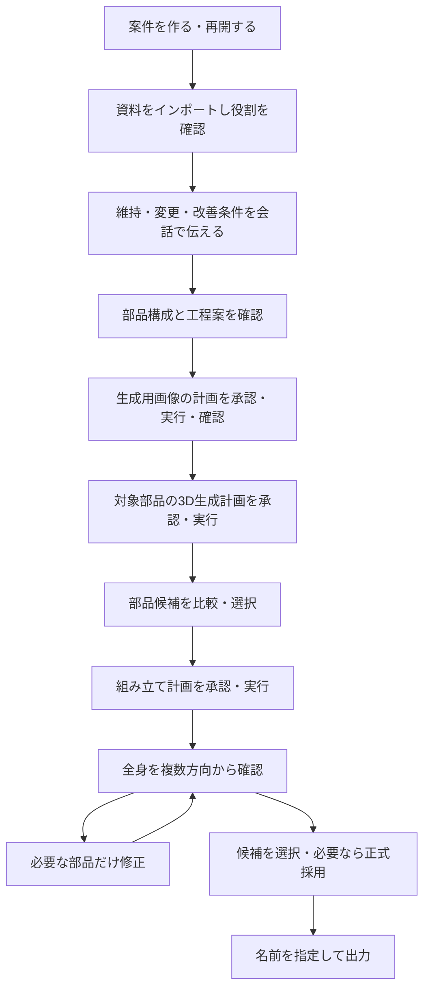

# キャラクター制作ハーネス 設計書 ver1.0

- 作成日：2026-10-18
- 状態：レビュー待ち。既存の合意と今回の追加要求を設計へ整理した案。
- 対象リポジトリ：`ThdModelCreator`、作成時ブランチ：`ver1.0`
- 現在の実装状況：AGENTS.mdとGit管理のみ。本文のCLI・データ形式・機能は未実装。
- 重要な追加設計は第16章で利用者の確認を受けてから確定する。文書作成は実装・生成実行・新規依存導入の承認とは扱わない。

## 1. 目的と設計上の優先順位

三面図・設定画等を取り込み、Codexとの日本語の会話からキャラクターを部品単位で生成・組み立て・修正し、レビューと選択を経て成果物を出力する、単一ユーザー向けのローカルCLIハーネスを構築する。

今回追加された利用者要求は、**インポートから指示、出力までの流れと操作感を、既存の画像生成ハーネスに揃えること**。利用者が通常の制作でCLI構文、UUID、Blenderの細かな操作を覚えることを前提にしない。Codexが会話を受け、管理CLI経由で記録・操作する。

優先する体験は次のとおり。

1. 「この資料で、このキャラクターを作りたい」と依頼できる。
2. 資料の役割と、維持・変更・改善したい条件を確認できる。
3. 実行前に、何を作るか・どこを変えるか・どこを保持するかを確認できる。
4. 結果を画像で比較し、「帽子だけ大きく」のように修正できる。
5. 候補の選択と最終採用を区別し、名前を付けて出力できる。
6. 会話が変わっても元資料、制作状態、過去候補を復元できる。

見た目の品質は工程別に確認し、生成完了をゲーム用途での完成とみなさない。

## 2. 根拠資料と適用範囲

| 資料 | 本設計での扱い |
| --- | --- |
| [3D企画書 ver0.2](https://app.notion.com/p/3fcf252ab683814c863df33656ed84bf) | キャラクター、部品分解、資料整理、既存TripoSRとBlenderの併用の基準 |
| [画像ハーネス仕様 ver4.1](https://app.notion.com/p/3f4f252ab68381e8bc40dc251b3ca08c) | 案件・資料・要件・計画・承認・候補・レビュー・採用・保存の基準 |
| [画像ハーネス仕様 ver4.2](https://app.notion.com/p/3fcf252ab68381abb8eed67a27a47e71) | 完全なID表示、一覧キャッシュ、VS Code表示、端末出力の基準 |
| [画像ハーネス仕様 ver4.3](https://app.notion.com/p/3fcf252ab6838108acf0dc0b7fd1d8fa) | selected候補の名前付きエクスポート、確認、manifestの基準 |
| [画像ハーネス操作マニュアル](https://app.notion.com/p/3fbf252ab683813c8135c84d8a81c0af) | 利用者の操作順、会話例、実装上の制限を確認する資料 |
| [AGENTS.md](../AGENTS.md) | 本リポジトリの作業・承認・環境保護指針 |
| `C:\AI_test\TripoSR\LOCAL_VERIFICATION.md` | 過去の実機検証記録。今回の設計作業で再実行した結果ではない |

画像ハーネスはver4.1にver4.2・ver4.3の差分を適用した操作仕様を参照する。古い版の設計や、操作マニュアルに記載された未実装事項を、動作済みの事実として継承しない。既存画像ハーネスのコードは今回参照していないため、コードの共有可否・互換性は未確認。

本書は独立した3Dハーネスの設計であり、画像ハーネスの運用データやJSONスキーマとのバイナリ互換・自動移行は約束しない。

## 3. 決定済み事項と今回提案する事項

### 3.1 これまでに合意した事項

- キャラクターを対象に、身体ベースと独立した髪・装備・持ち物を併用する。
- Codexが資料を照合して部品分解案を作り、元資料を保持したまま生成用画像を準備する。
- TripoSRを初期形状生成用に呼び、Blenderを組み立て・局所編集・検査の基盤にする。
- 元資料・候補を上書きせず、派生と履歴を残す。計画の承認と候補の採用を分ける。
- 既存TripoSR環境を維持し、システム全体への変更は事前確認する。
- インポートから指示・比較・出力まで、画像ハーネスと似た操作にする。

### 3.2 本書の具体化に伴う提案

- CLIの仮称を `mwb`、実装をPython 3.11以上、初期実行依存を最小限とする。
- 案件管理用の仮想環境と、TripoSRの仮想環境、Blender内蔵Pythonを分離する。
- 保存はローカルJSON・成果物ファイル、一覧は画像ハーネスと同様のエディタ表示にする。
- 全身候補と部品候補を分け、通常の一括出力はselectedの全身候補を対象とする。
- 第1実装範囲を資料・部品・計画・候補管理から静止状態の組み立て・修正・復元までとし、外観・UE・動作を段階実装する。

これらは第16章の確認対象であり、以下の構文例・パスはこの案に基づく。未承認の技術選択を確定事項として実装へ進めない。

## 4. 利用者が行う制作フロー



既存の適切な生成用画像や身体ベースがあれば、新しい画像生成を省略できる。工程を省略した理由と使用資産は記録する。

### 4.1 典型的な会話

**取り込みと計画**

> 新しい案件「青い旅人」を作ってください。正面・側面・背面の資料を取り込んで、頭身と配色を維持してください。身体、髪、帽子、持ち物の構成案を出してください。まだ生成せず、使う資料と未確定事項を確認したいです。

Codexは元画像を不変コピーとして登録し、役割・方向・優先順位・使用しない要素を確認する。全資料の照合結果と矛盾、未確定の身体ベースを説明する。この依頼は画像生成や3D生成の承認ではない。

**実行の確認**

> 提示された計画のうち、帽子の生成用画像を1案作成してください。

Codexは、直前に提示した一意の計画IDと内容を記録して承認を関連付ける。利用者が毎回UUIDを手入力する必要はない。複数計画のどれを指すか不明なら確認する。承認対象外の他部品を生成しない。

**修正**

> この候補の帽子だけ10%大きくしてください。頭と身体、持ち物は変えないでください。

Codexは対象候補・部品IDと変更範囲を特定し、局所編集の計画を提示する。承認後に派生候補を作る。局所編集で可能な内容を無断でTripoSR再生成へ変更しない。

**比較・選択・出力**

> 修正前後を同じ角度で見せてください。修正後を選択し、「青い旅人」という名前で出力してください。

Codexはレビュー用画像と保持条件の検査結果を提示する。利用者の明示的な選択と出力指示を対象候補へ関連付け、出力対象と保存先が確定していれば同じ承認を繰り返し求めない。対象が増減したり、形式変換や品質上の未確認事項が生じたりした場合は差分を提示する。

### 4.2 操作感の対応表

| 画像ハーネス | 3Dハーネスで揃える操作 | 3D固有の追加 |
| --- | --- | --- |
| project create/list/show/status | 同じ案件操作と日本語の状態案内 | 制作段階、部品、未解決依存を表示 |
| reference add/list/update | ファイル指定で取り込み、役割・説明・優先度を付与 | 正面・側面・背面等の方向、対象部品、寸法根拠 |
| requirement add/update/history | must_keep / must_change / improveと理由・履歴 | 全身・特定部品、形状・外観・動作への適用範囲 |
| generate plan/show/request-approval/approve | 固定計画を提示し会話で承認 | 画像準備、部品形状、組み立て等の工程指定 |
| edit plan --source | 親候補を指定して修正計画を作る | 局所変形・部品交換・再生成を区別 |
| candidate list/open/compare | 複数候補を同条件の画像で確認 | 方向別プレビュー、構造検査、部品構成 |
| review/select/hold/reject | 評価・選択と正式採用を分離 | 工程別の合格条件・未検証範囲 |
| project set-approved | 全身の採用版は案件ごとに最大1件 | 部品の選択と全身の採用を混同しない |
| project export --name | selectedを名前付きで出力、manifestで追跡 | 全身のみを標準対象とし、依存テクスチャ等を同梱 |
| list --terminal / cache clear | 一覧の全文表示・待たないVS Code表示 | 3Dハーネス専用キャッシュへ分離 |

## 5. 取り込み・資料整理・部品構成

### 5.1 資料

初期画像形式はPNG/JPEG/WebP。元ファイルは変更せず案件内へコピーし、デコード、実形式、寸法、MIME、SHA-256を検証する。外部の取り込み元パスは許可するが、登録後の管理対象は案件内のコピーとする。

- role：pose / silhouette / design / face / color / orthographic / part / style / other。
- description：使う要素・使わない要素を自由記述する。
- priority：整数1〜5、1が最高、既定3。合成率ではない。
- view：front / side_left / side_right / back / perspective / multiple / unknown。
- target_part_ids：対象部品。未分解時は未指定を許可する。
- scale_evidence：実寸・比率の根拠。推定値と確定値を区別する。

自由な複数タグ機能は初期必須とせず、画像ハーネスの役割・説明・優先度を基準にする。同一画像を複数役割で参照する場合は画像実体を共有できるが、参照レコードとメタデータの履歴は分ける。

全資料を読む工程と、個々の実行で使用する資料を固定する工程を分ける。計画に未指定の資料を実行直前に暗黙追加しない。ファイルの登録だけでCodexが画像を視覚的に確認したことにはせず、実際に画像を参照できなければ解釈工程を停止する。

### 5.2 要件

categoryは画像ハーネスと同じmust_keep / must_change / improve。禁止事項は明確な要件文と計画のavoid_conditionsへ記録し、曖昧な否定表現を放置しない。対象範囲はprojectまたはpart、評価観点はgeometry / surface / motion / export等とする。

更新・廃止は理由と差分を追記し、過去計画の要件を変えない。意味上の矛盾が自動ですべて検出できるとはせず、Codexが確認する。

### 5.3 部品構成

身体・腕・脚は連続するベースを基本とし、髪・帽子・装備・持ち物を独立部品の候補とする。頭や密着衣服の分離は接続・変形条件を確認して個別に決める。

PartPlanを版管理し、各Partへ以下を記録する。

- 安定したpart_id、名前、役割、参照ID、保持条件。
- 生成方式：triposr / base_asset / procedural / supplied_asset。
- 目標寸法・比率、未確定事項、左右差・対称性。
- ローカル軸、接続先part_id、接続アンカーと位置・回転・スケール。
- 追従方式：rigid / skinned / none、接合方式：separate / surface_join。

初期の共通座標系案は右手系・Z上・メートル、キャラクター正面は-Y。TripoSR出力は正規化された大きさとして扱い、画像から実寸を確定しない。アダプタで明示変換し、UE向け単位・軸変換は書き出しプロファイルに記録する。

既存身体ベースの入手元・ライセンス・変形品質は未決。利用可能なベースがあるとは仮定しない。

## 6. 生成・編集・承認の設計

### 6.1 工程と実行方式

| stage | 内容 | 実行方式 |
| --- | --- | --- |
| image_prepare | 切り抜き等、または資料を踏まえた画像作成 | ローカル処理／Codex会話からの画像受け渡し。描き起こし機能の選定は未決 |
| geometry | 一枚の承認済み入力画像から対象部品の初期形状を生成 | 既存TripoSR環境のサブプロセス |
| assembly | 固定した身体・部品候補の配置と親子付け | Blenderバックグラウンド |
| surface | UV、色、マテリアル、ベイク | 後続実装。TripoSRの色をPBR一式と扱わない |
| game_prepare | 軽量化、衝突、リグ等のゲーム用加工 | 後続実装。静的／動的を区別 |

生成用画像作成は画像ハーネスと同様、会話での生成とCLIでの登録を分けられる構成にする。CLIが会話内の画像生成機能を直接呼べるとは仮定しない。外部APIへの自動切替や費用の発生する代替経路を標準実装しない。

画像生成機能が未選定・利用不可・出力受領不可ならimage_prepareをblockedにする。手元の適切な画像を登録して使う方法は、別の計画として確認する。画像利用枠が不明なら残量を断定せず、上限表示時は停止する。

TripoSRは画像を複数並べても同一物体の複数視点として統合しない。各geometry実行の入力画像は対象部品ごとに1枚に固定する。

### 6.2 固定計画

Generationの日本語名称は画像ハーネスに揃え「生成計画」とし、画像生成・3D生成・編集・組み立てを含む実行記録として扱う。承認画面では実際の操作名も併記する。

固定部分にproject_id、operation、stage、target_part_ids、親候補、資料IDとhash・メタデータ、要件版、PartPlan版、使用画像・資産のhash、保持・変更・禁止条件、具体的操作、出力予定、設定・アダプタ版、環境識別情報、実行上限を含め、plan_hashを計算する。

計画後の要件変更は自動反映しない。承認は計画IDとplan_hashに結び付ける。固定入力が変わった場合は停止し、新しい計画を作る。まだ存在しない生成用画像や「その時点の最新の部品」を固定済みの入力とみなさない。前工程の結果を選択後に次工程の計画を作成する。

編集の操作種別はtransform / local_deform / replace_part / regenerate_part / surface_edit等を区別する。Blenderの任意コード文字列を利用者入力からそのまま実行せず、実装済みの名前付き処理と検証済みパラメータへ変換する。未対応の編集は理由を示し、別案の確認へ戻す。

### 6.3 状態

```text
draft -> awaiting_approval -> approved -> running
                                         |-> succeeded
                                         |-> partially_succeeded
                                         |-> failed
                                         |-> result_unknown
draft / awaiting_approval / approved -> cancelled（未開始の場合）
draft / awaiting_approval / approved -> blocked（開始条件を満たさない場合）
```

画像ハーネスのapproveはrunningへの遷移記録だったが、3D案では**承認と実プロセス開始を分けるためapprovedを追加する**。これにより、承認だけでBlenderやGPU処理が始まったと誤認しない。

- plan・request-approval・approveは生成プロセスを起動しない。
- executeまたはstart-externalで、開始前検査と開始記録後にrunningへ遷移する。
- 外部画像生成はstart-external記録成功後にCodex側が開始し、得たファイルをregisterする。
- ローカル実行はexecuteが起動・待機・検証・登録まで担当する。
- 成果物の検証・保存・再読み込みが成功して初めて候補を確定する。
- partially_succeededは独立に利用できる候補が一部保存された場合に限る。壊れた全身候補を部分成功として公開しない。
- result_unknownは結果・プロセスの確認が済むまで、同じ対象への重複実行を禁止する。会話中断だけで自動再試行しない。
- cancelは未開始計画の取消。実行中プロセスの停止は別操作とし、終了を確認できなければresult_unknownにする。
- 終端状態を再承認・再実行しない。再試行は入力を固定した新計画とし、保存済み成果物は再利用可能性を確認する。

### 6.4 承認の負担と範囲

読み取り・取り込み・要件登録・計画作成は、利用者が依頼した範囲で進める。画像／形状生成、モデル編集は対象と具体的内容を提示して承認する。承認済み操作に必要な検査・プレビュー・レポート作成は計画に含め、処理ごとに確認を繰り返さない。

会話承認には対象ID、計画hash、承認範囲、日時、確認文の要旨を記録する。これはローカル監査用の記録であり、本人認証や改ざん不能な署名ではない。非対話CLIで入力待ちを発生させず、承認記録が不足する場合は停止する。

候補の採用、破壊的操作、費用・外部送信・システム変更は、その内容を明示した承認が必要。過去に別の生成を承認したことを新しい生成への包括承認とは解釈しない。

## 7. 候補・組み立て・レビュー

### 7.1 候補の種類と固定性

Candidate.kindはprepared_image / part / character。prepared_imageは生成用画像、partは単独部品、characterは固定した構成を持つ全身候補を表す。characterの制作段階はgeometry / surface / game_ready等で別管理する。game_readyは自動的な品質保証名として使わず、必要な検証結果を併記する。

候補の成果物と構成内容は不変とする。候補状態・レビュー等の変更は履歴として記録する。選択状態はpending / selected / on_hold / rejected。selectedは複数許可するが、正式採用のproject.approved_candidate_idは同じ案件のcharacterを最大1件とする。

組み立て候補は部品候補IDとhash、PartPlan版、各配置変換、アンカー、追従方法を固定した構成スナップショットを持つ。後から別の部品がselectedになっても既存の全身候補は変化しない。比較や修正の親は明示したcandidate_idとする。

身体ベース等の取り込み資産も使えるよう、構成の各part_idの入力はcandidate_idまたはasset_idのどちらか1つとする。資産の場合もhashと依存ファイルを固定し、外部の元ファイルを直接参照しない。必要な部品の未割当、同一部品への二重割当、循環した親子関係は計画作成時に拒否する。

### 7.2 編集性と保持検査

部品名・階層・part_idを.blendに保持し、候補の構成スナップショットと対応させる。別部品のまま利用できる装備を無理に表面接合しない。

保持対象の部品について、元資産のhashと構成参照、頂点・面・材質データ、オブジェクト変換等を検査する。.blend全体のバイトhashだけでは「帽子以外を保持した」と証明できない。数値上の保持と見た目の一致を分け、必要なら固定カメラ画像でも比較する。

形状修正でUV・ベイク・ウェイトが影響を受けた場合、新候補では依存する品質ゲートを未検証へ戻す。過去候補のレビューは改変せず残す。

### 7.3 レビューと表示

- 正面・左右側面・背面・斜めの固定プレビューを基本とし、顔・接続部は必要に応じ拡大する。
- compareは同じカメラ・照明・表示スケールを使い、そのプロファイルを記録する。
- 旧候補に比較用画像がなければ、元ファイルを変更せず派生プレビューを別領域へ作る。
- 目視レビューと構造検査を分け、要件ごとにpass / fail / uncertain / not_applicableと理由を保存する。
- 自動処理はファイル整合性、面数、法線、境界・非多様体、寸法、部品欠落等を検査する。資料への忠実性を機械的に合格にしない。
- project set-approvedはselectedのcharacterだけを対象とする。未レビュー・未達要件がある場合は明示確認と理由を残し、ゲートの合否自体を偽らない。

## 8. CLIの構成案

CLI名 `mwb` は仮称。すべてに日本語helpを用意する。案件対象のコマンドではproject_idを明示し、「現在の案件」の暗黙状態は設けない。UUID v4を省略せず表示し、会話上は名前とIDを対応付けて扱う。

### 8.1 画像ハーネスと共通の基本コマンド

```text
mwb status [<project-id>]
mwb config show
mwb doctor
mwb project create --name <name> --goal <text>
mwb project list [--terminal]
mwb project show <project-id>
mwb project archive <project-id>
mwb reference add <project-id> <image-path> --role <role> --description <text> [--priority <1..5>] [--view <view>] [--part <part-id>]
mwb reference list <project-id> [--terminal]
mwb reference show <project-id> <reference-id>
mwb reference update <project-id> <reference-id> ... --reason <text>
mwb requirement add <project-id> --category <category> --text <text> [--part <part-id>]
mwb requirement list <project-id> [--terminal]
mwb requirement update <project-id> <requirement-id> ... --reason <text>
mwb requirement retire <project-id> <requirement-id> --reason <text>
mwb requirement history <project-id> [<requirement-id>]
```

doctorは設定、必要ファイル、既存実行環境への到達性等を検査し、勝手にインストール・更新・GPU生成を行わない。archiveは読取専用化し、実行中・結果不明の処理があれば拒否する。

### 8.2 3D向けの部品と資産

```text
mwb part plan <project-id> --file <part-plan-json>
mwb part list <project-id> [--terminal]
mwb part show <project-id> <part-id>
mwb asset add <project-id> <asset-path> --part <part-id> --description <text>
```

part planの入力JSONはCodexが計画作成用に準備できるが、正式な運用データへの書き込みはCLIが検証して行う。変更は新しいPartPlan版として保存する。部品構成は実行計画の承認に含める。

asset addは身体ベースや既存部品等を取り込む。初期対応形式の案は.blend / .objと付随ファイル。形式ごとの検証・依存列挙が実装済みの場合だけ受理し、未知形式を拡張子だけで成功にしない。FBXの外部取り込みは後続対応。身体ベースの利用条件を記録する欄を持つ。

### 8.3 計画と実行

```text
mwb generate plan <project-id> --stage <stage> --prompt <text> [--part <part-id>] [--reference <reference-id>]... [--input <prepared-image-id>] [--recipe <recipe-path>]
mwb edit plan <project-id> --source <candidate-id> --stage <stage> --prompt <text> --operation <operation> [--part <part-id>] [--reference <reference-id>]... [--recipe <recipe-path>]
mwb generate list <project-id> [--terminal]
mwb generate show <project-id> <generation-id>
mwb generate request-approval <project-id> <generation-id>
mwb generate approve <project-id> <generation-id> --plan-hash <hash> --evidence <text>
mwb generate execute <project-id> <generation-id>
mwb generate start-external <project-id> <generation-id>
mwb generate register <project-id> <generation-id> <file-or-bundle-path>...
mwb generate block <project-id> <generation-id> --reason-code <code> --message <text>
mwb generate mark-unknown <project-id> <generation-id> --reason <text>
mwb generate fail <project-id> <generation-id> --reason-code <code> --message <text>
mwb generate cancel <project-id> <generation-id> --reason <text>
mwb generate inspect <project-id> <generation-id>
mwb generate interrupt <project-id> <generation-id> --reason <text>
```

生成・編集は同じGenerationとして実行・状態管理し、edit planは親候補の指定を必須にする。stageごとに必須引数と禁止引数を検証する。geometryの--inputは保存済みprepared_image候補、assemblyの--recipeは部品候補を明示する入力文書で、固定内容を計画へ取り込む。プロンプトだけで未知のBlender処理が実行できるとは扱わない。

初期のgeometryは1部品・1入力・1実行を単位とする。同じ画像から同設定で4体を自動生成するような、画像ハーネスの希望枚数既定4の機械的な継承はしない。画像準備の希望数、TripoSRの実行数、部品数、保存候補数を区別する。複数案は入力・設計の異なる計画で比較する。

registerはrunningまたは結果確認済みresult_unknownからだけ受理し、計画ID・成果物hashで重複を検出する。外部画像を受け取れなければ候補登録を成功と報告しない。候補が1件完成してから終端化するまでの書き込みを復旧可能にし、同じ結果から二重候補を作らない。

### 8.4 候補・レビュー・出力

```text
mwb candidate list <project-id> [--kind <kind>] [--part <part-id>] [--generation <generation-id>] [--terminal]
mwb candidate show <project-id> <candidate-id>
mwb candidate open <project-id> <candidate-id> [--model]
mwb candidate compare <project-id> <candidate-id-1> <candidate-id-2>...
mwb review <project-id> <candidate-id> --file <review-json>
mwb candidate select <project-id> <candidate-id> --reason <text>
mwb candidate hold <project-id> <candidate-id> --reason <text>
mwb candidate reject <project-id> <candidate-id> --reason <text>
mwb project set-approved <project-id> <candidate-id> --reason <text>
mwb report show <project-id> <generation-id>
mwb report open <project-id> <generation-id>
mwb project export <project-id> [--name <name>] [--profile <profile>]
mwb cache clear [<cache-id>]
```

openの既定はプレビューを開く操作。--modelだけがBlenderの対話画面を開く。通常の検査・変換用Blenderはバックグラウンド実行とし、作業に不要なウィンドウを出さない。

対話端末からの一覧表示は画像ハーネスver4.2と同じく、取得時点の全文を専用キャッシュへ保存し、VS Codeへ表示を依頼して待たずに戻る。エディタ不可なら端末へ全文を表示する。--terminal、非対話呼び出し、パイプ、リダイレクトではエディタとキャッシュを作らない。0件は件数だけを表示する。ID、長い名称、日本語、改行を省略・装飾解釈しない。

一覧は操作用の正本ではなく参照コピー。編集しても案件に反映しない。専用キャッシュの案は `%LOCALAPPDATA%/ThdModelCreator/cache/lists/`、未設定時は `~/.cache/thd-model-creator/lists/`。自動削除せず、cache clearで対象確認後に既知のキャッシュだけ削除する。案件データやエディタの履歴を削除しない。

### 8.5 終了コード

0：成功（対象0件を含む）、2：構文・引数、3：入力・設定・成果物検証、4：ID・案件不一致・状態・ロック競合、5：アダプタ実行・外部出力受領の失敗、6：読込・保存・ログ・レポート等の失敗、130：利用者の取消・中断。

終了コードと日本語の理由・保存済み状態・次の操作を併記する。部分成功は保存候補と失敗範囲を示し、失敗要因に応じた非0コードを返す。レポート失敗を理由に完成済みの候補を破棄しない。

## 9. 出力の仕様案

### 9.1 対象と命名

画像ハーネスver4.3に揃え、案件内のselected候補を一括出力する。ただし3Dでは、**通常の対象をkind=characterのselected候補すべてに限定する**。selectedの部品や生成用画像を、完成キャラクターと同列に出力しない。対象外件数を確認画面に表示する。部品単独出力は初期必須とせず、追加設計で明示する。

approved_candidate_idは正式採用の指標であり、通常出力の件数を変えない。部品のselected状態を変えても、既存characterの構成や出力は変わらない。

- --name省略：候補IDを名前とする。
- --nameあり、1件：基本名を使う。
- --nameあり、2件以上：基本名_001、基本名_002の順。候補ID昇順で割り当て、1000件以上も桁を拡張する。
- 同梱する複数形式は1候補を1件と数える。モデル形式の数を候補数に数えない。
- 0件：日本語で通知して正常終了し、空の出力を作らない。
- 出力名はパス・拡張子として解釈せず、Windows禁止文字・予約名・末尾の空白やピリオド・完成ファイル名の長さを検証する。不正名を無断で置換・短縮しない。

### 9.2 プロファイル

- source：初期対応。.blendを編集原本として、保存済みOBJ等、必要なテクスチャ、プレビュー、検査結果、構成記録を同梱する。既定プロファイル案とする。
- ue_static：後続対応。指定用途のStatic Mesh用にFBX・テクスチャ・衝突等を準備する。
- ue_skeletal：後続対応。骨格・ウェイト・基本動作とUEでの検証が必要。

profileは実装済みのものだけ受理する。source出力成功をUEインポート済みと表示しない。変換が必要なら、変換計画の条件と出力予定を提示して実行する。出力時の変換では元候補を改変せず、書き出し用コピーに対して処理する。

### 9.3 出力単位と完全性

```text
exports/<export-id>/
  青い旅人_001/
    青い旅人_001.blend
    青い旅人_001.obj
    textures/...
    previews/...
    checks.json
    composition.json
  青い旅人_002/...
  manifest.json
```

上は複数候補の例。1件なら連番なしのフォルダ・基本名を使う。案件内の新規export_id配下へ毎回作り、過去出力を上書きしない。実際に保存していない形式のファイルを必須として偽装しない。

manifestにはschema_version、export_id、project_id、profile、選択時点、候補IDと名前の対応、各ファイルの相対パス・hash・用途、出所候補・生成計画・構成版・変換条件、UE確認状況を含める。

出力前に件数・候補・ファイル名・形式・保存先・未検証点を提示し、承認したスナップショットをロック下で再確認する。対象変更時は停止する。依存を列挙・検証し、案件外の絶対参照や欠落テクスチャを放置しない。.blendでは対応する画像のパックまたは相対配置、OBJ/MTLでは相対参照の整合を確認する。

sourceでコピーするファイルはコピー前後のhashを照合する。変換・依存パス書換えを行う場合は元hashと変換後hash・処理を区別して記録し、再読み込み検査を行う。すべて成功した後だけ一時フォルダから正式出力へ確定する。途中失敗は正式な一部出力を公開せず、復旧用領域と理由を記録する。

## 10. データと保存構成案

### 10.1 コードと環境

```text
ThDModelCreator/
  AGENTS.md
  docs/design-v1.0.md
  pyproject.toml                   # 実装開始後
  src/model_workbench/
    cli.py                        # 利用者向け構文・表示
    domain/                       # 案件・要件・計画・候補・状態
    storage/                      # 検証・保存・ロック・履歴
    adapters/                     # image handoff / TripoSR / Blender
    blender_scripts/              # 名前付きの検証済み処理
    reporting/                    # レポート・一覧・比較表示
  tests/
  config.example.toml
  config.local.toml                # 個人パス、Git対象外
  projects/                       # 制作データ、Git対象外
```

これは承認待ちのモジュール構成案。初期は小さな実装から分け、空の抽象化やプラグイン基盤を先行作成しない。CLI管理環境へtorchやBlenderをインストールせず、各既存実行環境へ明示パスで呼び出す。Pythonの版や実行依存の採用は承認後に必要性を確認する。

### 10.2 案件データ

```text
projects/project-<uuid-prefix>/
  project.json
  requirements.json
  references/                     # 不変画像、参照indexと履歴
  assets/<asset-id>/               # 身体ベース等と依存・出所情報
  part-plans/<part-plan-id>.json   # 不変の版
  generations/<generation-id>/
    plan.json                     # 固定入力、plan_hash
    execution.json                # 状態・承認・試行経過
    events/                       # 順序付きイベント
    work/                         # 隔離した実行・復旧領域
    outputs/<candidate-id>/       # 検証済み成果物一式
    stdout.log
    stderr.log
  candidates/<candidate-id>.json
  reviews/<review-id>.json
  previews/<preview-id>/           # 不変成果物からの追加比較用
  reports/<generation-id>.md
  reports/<generation-id>.json
  exports/<export-id>/
```

### 10.3 共通データ契約

- 管理レコードにschema_version=1、UUID v4、案件ID、UTC ISO 8601日時を持たせる。未知schemaは書き換えず停止する。
- Planの固定内容とExecutionの状態を分け、変更する状態がplan_hashを変えないようにする。
- 候補にgeneration_id、parent_candidate_id、kind、stage、part_id、成果物manifest、構成スナップショット、選択履歴を持たせる。
- 管理対象ファイルの保存パスは案件ルート相対POSIX形式。入力元の外部パスや実行環境パスを、案件内成果物への参照として使わない。
- レポートは承認範囲、実行段階、資料・部品、保存数、検査、レビュー、エラー、次の操作を日本語で示す。会話全文は初期保存対象としない。
- 公式データはCLI経由で変更する。生成用の入力JSONと、直接書き換えてはいけない正式データを区別する。

## 11. 実行環境・アダプタの境界

TripoSRの既存環境は `C:\AI_test\TripoSR`、既存Pythonは同配下の `.venv\Scripts\python.exe`、Blenderは検証済みの5.2.0 LTSを候補とする。これらは2026-10-17の検証記録に基づき、doctorで存在・版を再確認する。設定はパスを外部化し、設定値と出所を表示する。

設定ファイルの探索基点は、起動場所によって意図せず別案件へ変わらないよう、明示--configを優先し、それ以外は作業ディレクトリから上位へ探したプロジェクト設定を用いる案とする。相対パスは設定ファイルの位置を基準に解決し、曖昧なら停止する。

TripoSR初期値はchunk_size=1024、mc_resolution=128。部品は順次処理し、GPU実行ロックでTripoSRとBlenderの重い処理を同時起動しない。並列生成・常駐モデル・GPUの自動選択変更は初期対象外。UEの手動起動をロックだけで制御できるとは保証しない。

サブプロセスは引数配列・shellなしで起動し、cwd・環境変数・出力先・ログを明示する。TripoSRのコード、仮想環境、モデルキャッシュを無断で変更しない。Hugging Face等のキャッシュは既存検証済み配置を設定で指定する。新しいキャッシュ配置や重み取得が必要なら実行前に説明し、既存環境の書き込み権限を前提にしない。

終了コード0だけでは成功とせず、ファイルの存在・サイズ・hash・再読み込みと、非空メッシュ・有限値・面インデックス等を検証する。Blenderスクリプトは対象候補のコピーを処理する。

CLIの処理実行は承認状態を検証したサービス経由に限定し、コマンドを直接呼んでも未承認計画を起動できないようにする。バックエンドが利用不可の場合に別モデルへ無断切替しない。

## 12. 保存・排他・障害回復

- 入力を先に検証し、一時領域でコピー・flush・再読み込み・hash検証後に確定する。確定済み候補は原本として保持する。
- 案件更新は案件単位で排他する。長い外部処理中は実行予約を保存し、読取は可能にする一方、同一案件の競合書き込み・重複起動を拒否する。
- 案件ロックとGPU実行ロックを区別する。残存ロックを時間経過だけで奪わず、PID・開始時刻・プロセス識別を照合する。
- 複数ファイルをまたぐ更新は、操作IDと確定manifest／イベントを使い、再開時に中途状態を識別する。JSON単体のrenameだけで複数レコードの整合が保証されたとはしない。
- 実行開始を記録したが起動結果を確認できない、中断後にプロセスの生存が不明、成果物とindexの確定が食い違う場合はinspectで照合する。推測で再実行しない。
- OOM時は失敗設定と計測を保存し、解像度低下・CPU切替・再生成を自動実行しない。新しい条件を提示して承認を受ける。
- Windowsのリンク・ジャンクション・案件外パスを管理領域の入力として拒否し、外部入力は検証してコピーする。実行ファイル用の外部パスは別の設定契約で許可する。
- 信頼できない.blendを取り込む際は自動実行スクリプトを無効化し、依存を検査する。参照画像・テキストは制作資料であり、そこに書かれた指示で承認・保護規則を変更しない。
- 手動復旧が必要な場合、対象と残存状態をレポートし、汎用の再帰削除や直接JSON編集を通常運用にしない。
- 案件全体をバックアップ対象とする。Gitはコードと設計書の管理用であり、モデル・画像・履歴のバックアップの代わりにしない。

## 13. 段階実装と受け入れ条件

### 第1段階：案件管理と操作の互換性

資料取り込み、役割・方向・要件、部品構成、固定計画、承認記録、一覧・status・レポートを実装する。実生成なしの試験データで検証する。

- 会話またはCLIで資料を取り込み、元ファイルを変えずに追跡できる。
- 明示指定した資料と要件版だけが計画に固定され、plan作成で生成が始まらない。
- 長い名前・日本語・完全UUIDが一覧で欠落せず、--terminalと非対話ではGUIが起動しない。
- 対話時の一覧キャッシュ、エディタ不可時の端末表示、専用キャッシュの明示削除が機能する。
- 未承認、案件違い、hash変更、結果不明、未知schemaの実行を拒否する。

### 第2段階：部品生成と静止モデルの組み立て

既存TripoSR呼出し、ファイル受け渡し、Blender取込み・配置・プレビュー、transform / replace_partの限定編集を実装する。複雑な顔の修正や汎用局所編集を同時に実装しない。

- 明示承認した1部品だけを生成し、元環境を変更せず計測・登録できる。
- 身体ベースと帽子・持ち物等の少数部品を固定構成で組み立てられる。
- 帽子だけの拡大と持ち物の交換を派生候補として実行し、保持対象を数値と画像で確認できる。
- 部品の選択を変更しても過去の全身候補は変わらず、元候補へ戻れる。
- 別会話から案件を読み込み、資料・候補・次の操作を復元できる。
- 対象キャラクター画像の一体生成／部品化／画像準備の比較は、個別承認した実験として修正工数も測る。

### 第3段階：選択と名前付きsource出力

- selectとset-approvedが別操作で、全身の採用版は最大1件。
- 通常出力はselectedのcharacterすべて。selectedのpartやprepared_imageを混ぜない。
- 名前なし、1件、複数件、日本語名、禁止名、0件、取消、確認後の対象変更を検証する。
- テクスチャ等の依存を含む出力を別場所で再読み込みでき、manifestから元候補を追える。
- 書き込み失敗・中断で不完全な正式出力を作らず、元候補と過去出力を保全する。

### 第4段階以降：外観・UE・基本動作

UV・色・材質、ue_static、骨格・ウェイト・ue_skeletal、待機・歩行・腕上げの順で検証する。静止形状の合格と動作合格を分け、UE上の未確認を未検証として表示する。

静止モデルから基本動作までが企画全体の目標。第1〜3段階だけの完了時は「管理・静止制作・source出力のMVP」とし、「ゲームで動くキャラクター制作完成」と報告しない。

### 横断的な検証

意味のあるテスト対象は状態遷移、承認範囲、hash固定、案件分離、パス検証、部分保存、重複登録、依存、ロック・中断回復、出力の完全性とする。通常の自動テストは小さな試験資産とアダプタ代替を使い、画像生成・重み取得・GPU負荷を暗黙に発生させない。実機統合検証は明示した計画で別途実施する。

## 14. 確認済み環境と未検証事項

過去の実機検証ではRTX 3050 Ti Laptop GPU（4GB）・RAM約16GB、Python 3.11.9、torch 2.2.2+cu121、NumPy 1.26.4、CUDA Toolkit 12.1、Blender 5.2.0 LTSを使用した。

椅子画像をchunk1024・解像度128でOBJにし、計測約18〜20秒、最大GPU割り当て約1939MiB、最大予約2344MiB、10,248頂点・20,420面、Blenderでの再読み込みを確認している。2回の結果hashが一致したことは、その画像・環境での結果であり、任意画像の再現性保証ではない。

キャラクター、部品組み立て、資料の画像変換による改善、身体ベース、GPUテクスチャベイク、顔・関節品質、UE表示と動作、BlenderやUE同時起動の余裕は未検証。TripoSRはこの設計の全工程を実現するモデルではなく、geometry工程の一部を担う。

## 15. 対象外と保留事項

- 初期からのWeb UI、デスクトップGUI、常駐サービス、複数ユーザー、MCP常駐接続。
- 汎用的な文章から任意のBlenderモデリングを完全自動化する機能。
- 顔の表情、精密な指、衣装・髪の物理、近距離の主役級品質の保証。
- 三面図の厳密な3D統合、実寸の無根拠な確定。
- 他モデルや外部生成サービスへの無承認フォールバック。
- 画像ハーネスのコード・運用データの直接移行。
- 自動push・公開や、資料・モデルのGitHubへの自動登録。

保留事項：最初の検証キャラクター、画像準備機能、身体ベースの出所、想定表示距離・画風・面数・テクスチャ予算、リグとアニメーション資産、UEの対象版・検証プロジェクト。これらを仮に埋めて実装・生成を進めない。

## 16. 承認対象と次の作業

AGENTS.md第2章に従い、次の重要な設計選択について確認を受ける。承認前でも本書の整理・修正はできるが、採用を前提に依存導入や実装を開始しない。

| ID | 提案 | 理由・影響 | 状態 |
| --- | --- | --- | --- |
| D-01 | 会話を窓口、CLIを正式データ更新の窓口にし、画像ハーネスの基本操作名を継承 | 操作感を揃え、工程固有の処理は内部へ分ける | 今回要求に基づく具体案・確認待ち |
| D-02 | CLI名mwb、Python 3.11以上、ローカルJSON、別仮想環境 | 既存環境と分離し、Blender・TripoSRを外部呼出しする。名前と構成を固定する判断 | 確認待ち |
| D-03 | 部品・全身・画像候補を分離し、通常出力はselectedの全身候補すべて | 画像ハーネスの一括出力を保ち、途中部品の混入を防ぐ | 確認待ち |
| D-04 | 承認approvedと実行runningを分離し、具体的な計画単位で実行 | 画像受け渡しとローカルプロセス実行を同じ管理へまとめる。承認記録の構文差が生じる | 確認待ち |
| D-05 | 第1〜3段階を先に実装し、source出力までを最初のMVPとする | UE・動作の目標は維持し、未検証の自動造形へ一度に拡大しない | 確認待ち |
| D-06 | 第10〜11章の保存構成・設定探索、メートル/Z上/-Y正面 | データの参照・座標変換・起動基点を統一する | 確認待ち |

承認後、最小スキーマと状態遷移を具体化し、利用者向けの会話例・CLI helpを先に用意して、第1段階から実装する。本設計書のNotionへの転載・コミット・pushは今回の作成作業とは別に扱う。
